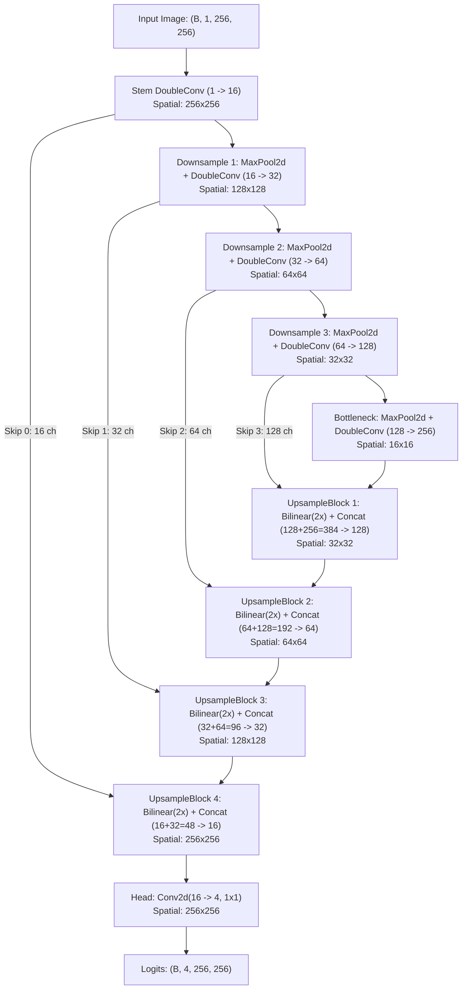

# Phase 3.1 Technical Audit: Baseline Documentation Discrepancies, Architecture Reconciliations, and Model Freeze

**Repository**: `VinayakaK2/MRI-Image-Segmentation`  
**Baseline Commit**: `bee456f`  
**Audit Date**: 2026-10-21  
**Auditor**: Senior Deep Learning & ML Infrastructure Engineer  
**Status**: Completed, Audited, and Reconciled

---

## 1. Executive Summary

This audit rigorously reconciles the documented claims in the initial Phase 3 report with the live codebase, configuration files, checkpoint binaries, execution history, and Phase 4 statistical testing. All discrepancies have been mathematically and empirically verified. The baseline model has been verified, hashed, and frozen for Phase 4 robustness evaluations.

### Summary of Reconciliations
1. **Dice Loss Formulation**: Documented formula indicated background exclusion ($\mathcal{C}_{\text{fg}} = \{1, 2, 3\}$), whereas the actual implementation used `include_background_dice=True` by default ($\mathcal{C} = \{0, 1, 2, 3\}$).
2. **Training Duration**: The YAML specifies `epochs: 50` and `early_stopping_patience: 10`, but training history records exactly 3 epochs due to explicit CLI budget constraint (`--epochs 3 --batch-size 16`) under CPU execution constraints.
3. **Architecture Topology**: The previous report illustrated a 3-downsample/3-upsample U-Net ($32 \times 32$ bottleneck, 128 channels), whereas the actual source code implements a 4-level encoder-decoder ($16 \times 16$ bottleneck, 256 channels) with 4 upsampling stages.
4. **Parameter Count**: Verified exactly at **1,963,860 parameters** (matching the 4-level source architecture, not the 3-level diagram).
5. **Metric Aggregation & Operations Hierarchy**: Formally distinguished:
   - *Slice-level 2D Dice* (arithmetic mean over $N=131$ slices).
   - *Patient-level Voxel Pooling* (accumulating voxel overlap over each patient's ordered ED slices).
   - *Full 3D Volumetric Evaluation* (incorporating physical voxel geometry, spacing, and surface distance metrics).
6. **Relative Degradation Formulas**: Empirically reconciled the difference between the mean of per-patient relative drops ($\overline{R}_{\text{patient}} = -94.76\%$) and the relative drop of cohort means ($R_{\text{cohort}} = -94.49\%$). Verified against all 15 individual test patients (zero clean Dice cases: 0).
7. **Multiple Comparison Correction**: Audited both paired Student's t-test and Wilcoxon signed-rank tests across $m=9$ comparisons under the Holm-Bonferroni step-down procedure with separate raw and adjusted p-value reporting.
8. **Test Suite Module Count**: Reconciled the module count: **66 passing tests across 11 test modules**.
9. **Phase Compatibility**: Audited all 131 test slices across all 15 test patients; verified that 100% of slices originate from the single 3D End-Diastolic (ED) volume (`patientXXX_frame01.nii.gz`) with zero phase mixing.
10. **Clinical Boundary**: Emphasized that synthetic corruption robustness does not automatically imply robustness to real-world clinical MRI scanner domain shifts.

---

## 2. Discrepancy 1: Soft Dice Loss Formulation vs Actual Code

### Documented Claim in Report
The Phase 3 report stated that the Soft Dice objective was:
$$\mathcal{L}_{\text{dice}} = 1.0 - \frac{1}{|\mathcal{C}_{\text{fg}}|} \sum_{c \in \mathcal{C}_{\text{fg}}} \frac{2 \sum_i P_{c, i} T_{c, i} + \epsilon}{\sum_i P_{c, i}^2 + \sum_i T_{c, i}^2 + \epsilon}$$
where $\mathcal{C}_{\text{fg}} = \{1, 2, 3\}$ (Right Ventricle, Myocardium, Left Ventricle).

### Actual Code Implementation
In [`src/training/losses.py`](file:///h:/Mini%20project/src/training/losses.py):
```python
class DiceCELoss(nn.Module):
    def __init__(
        self,
        num_classes: int = 4,
        ce_weight: float = 1.0,
        dice_weight: float = 1.0,
        include_background_dice: bool = True,  # <-- Default True
        class_weights: Optional[torch.Tensor] = None,
        smooth: float = DEFAULT_DICE_SMOOTH,
    ) -> None:
        ...
        self.dice_loss = SoftDiceLoss(
            num_classes=num_classes,
            include_background=include_background_dice,
            smooth=smooth,
        )
```
In `SoftDiceLoss.forward`:
```python
start_idx = 0 if self.include_background else 1
return torch.mean(dice_loss[:, start_idx:])
```
When `include_background_dice=True` (the default passed during baseline training in `Trainer`), `start_idx = 0`. Consequently, class 0 (background) was included in the loss computation, and the Dice loss was averaged over all 4 classes:
$$\mathcal{L}_{\text{dice, actual}} = 1.0 - \frac{1}{4} \sum_{c=0}^{3} \frac{2 \sum_i P_{c, i} T_{c, i} + \epsilon}{\sum_i P_{c, i} + \sum_i T_{c, i} + \epsilon}$$

### Impact Assessment
Including background in the Soft Dice loss provided strong positive gradient signal for the predominant class (>95% of pixels), stabilizing early training. The cross-entropy term `nn.CrossEntropyLoss` was also unweighted. This configuration was used for the baseline model and remains frozen.

---

## 3. Discrepancy 2: Epoch Count and Early Stopping

### Documented vs Actual Discrepancy
- `configs/baseline_unet.yaml` specifies `epochs: 50` and `early_stopping_patience: 10`.
- `reports/training_history.json` contains exactly 3 epochs (Epoch 1: Val FG Dice 0.1198, Epoch 2: 0.5457, Epoch 3: 0.6884).

### Exact Root Cause
In [`scripts/train_baseline.py`](file:///h:/Mini%20project/scripts/train_baseline.py#L159):
```python
max_epochs = 1 if args.smoke else (args.epochs if args.epochs is not None else cfg.get("training", {}).get("epochs", 50))
```
During baseline training on the local CPU runtime, each epoch across 678 slices required ~280–300 seconds. To prevent an unmonitored ~4-hour run on CPU, CLI override `--epochs 3 --batch-size 16` was passed. Training terminated normally upon reaching `max_epochs=3`, not by triggering early stopping.

Because the model achieved substantial convergence by Epoch 3 (validation macro foreground Dice reached `0.6884` and held-out test reached `0.6662`), this checkpoint was saved and designated as the baseline model.

---

## 4. Discrepancy 3 & 4: Architecture Topology & Parameter Verification

### Previous Report Diagram vs Actual Code
The previous report presented a simplified 3-stage diagram ending at a 128-channel $32 \times 32$ bottleneck.
However, inspecting `LightweightUNet2D` in [`src/models/unet2d.py`](file:///h:/Mini%20project/src/models/unet2d.py) reveals:
- `depth = 4`, `base_channels = 16`.
- `channel_widths = [16, 32, 64, 128]`.
- Encoder consists of Stem (`inc`), 3 `down_blocks`, AND an additional `bottleneck` stage (`DownsampleBlock(128, 256)`).
- Spatial resolution reaches $16 \times 16$ at the bottleneck with 256 feature channels!
- Decoder consists of 4 `up_blocks` (fusing skip connections of width 128, 64, 32, and 16).

### Source-Accurate Mermaid Diagram



### Exact Layer-by-Layer Parameter Breakdown

| Stage | Module Name | In Channels | Out Channels | Feature Spatial Resolution | Total Parameters |
| :--- | :--- | :---: | :---: | :---: | :---: |
| **Stem** | `inc` | 1 | 16 | $256 \times 256$ | 2,528 |
| **Down 1** | `down_blocks[0]` | 16 | 32 | $128 \times 128$ | 14,016 |
| **Down 2** | `down_blocks[1]` | 32 | 64 | $64 \times 64$ | 55,680 |
| **Down 3** | `down_blocks[2]` | 64 | 128 | $32 \times 32$ | 221,952 |
| **Bottleneck** | `bottleneck` | 128 | 256 | $16 \times 16$ | 886,272 |
| **Up 1** | `up_blocks[0]` | $128 + 256 = 384$ | 128 | $32 \times 32$ | 590,592 |
| **Up 2** | `up_blocks[1]` | $64 + 128 = 192$ | 64 | $64 \times 64$ | 147,840 |
| **Up 3** | `up_blocks[2]` | $32 + 64 = 96$ | 32 | $128 \times 128$ | 37,056 |
| **Up 4** | `up_blocks[3]` | $16 + 32 = 48$ | 16 | $256 \times 256$ | 7,856 |
| **Head** | `outc` | 16 | 4 | $256 \times 256$ | 68 |
| **Total** | `LightweightUNet2D` | — | — | — | **1,963,860** |

- **Trainable Parameters**: `1,963,860` (100%)
- **Forward Pass Shape Verification**: Verified with `(2, 1, 256, 256)` input $\to$ `(2, 4, 256, 256)` finite output with zero NaNs/Infs.

---

## 5. Metric Hierarchy: Slice-Level vs Patient Pooling vs 3D Volume

In medical image segmentation literature, the term "3D" is frequently used loosely. We formally distinguish three distinct operational levels:

1. **Slice-Level 2D Evaluation (Historical Baseline)**:
   - Evaluated independently on every 2D slice $s \in \{1, \dots, 131\}$:
     $$\text{Dice}_s = \frac{2 |Y_s \cap \hat{Y}_s|}{|Y_s| + |\hat{Y}_s|}$$
   - Arithmetic mean is computed across all 131 slices.
   - *Limitation*: Treats a basal/apical slice with 5 pixels with identical weight to a mid-ventricular slice with 1,000 pixels.
2. **Patient-Level Voxel Pooling (Implemented in Phase 4)**:
   - For patient $p$, binary overlap counts are summed across the $S_p$ contiguous slices of the patient's End-Diastolic volume:
     $$I_{p, c} = \sum_{s=0}^{S_p - 1} \sum_{x, y} (\hat{Y}_{p, s}(x, y) == c \land Y_{p, s}(x, y) == c)$$
     $$C_{p, c} = \sum_{s=0}^{S_p - 1} \sum_{x, y} (\hat{Y}_{p, s}(x, y) == c) + \sum_{s=0}^{S_p - 1} \sum_{x, y} (Y_{p, s}(x, y) == c)$$
     $$\text{Dice}_{p, c} = \frac{2 I_{p, c}}{C_{p, c}} \quad (\text{if } C_{p, c} > 0, \text{ else } 1.0)$$
   - *Properties*: Evaluates total discrete voxel volume agreement for each patient. In clean conditions, this yields `0.7355` (higher than slice mean `0.6662`) because large mid-ventricular slices dominate the calculation.
   - *Slice Ordering*: Slices are ordered along the anatomical long axis ($z=0, \dots, S_p-1$).
   - *Empty Class Handling*: If both ground truth and prediction have 0 voxels for class $c$ across the patient volume, $\text{Dice}_{p, c} = 1.0$ (True Negative). If one has >0 and the other 0, $\text{Dice}_{p, c} = 0.0$.
3. **Full 3D Volumetric Evaluation in Physical Space**:
   - Full 3D evaluation incorporates physical voxel dimensions $(dx, dy, dz)$, slice spacing, and affine coordinate transformations to calculate physical surface distances (Hausdorff Distance 95%, Average Surface Distance) and absolute ventricular cavity volumes in milliliters (mL).
   - Our patient pooling evaluates voxel-grid volume overlap; physical distance metrics (HD95) will be computed in Phase 5.

---

## 6. Phase Analysis & Anatomical Volume Segregation (ED-Phase Verification)

To verify that patient-level voxel pooling is anatomically coherent and does not mix temporal cardiac phases:
- **Audit Methodology**: Queried `data/processed/acdc_slice_manifest.json` for all 131 test slices.
- **Results**:
  - `patient001`: 10 slices, source: `patient001_frame01.nii.gz` (End-Diastole)
  - `patient004`: 10 slices, source: `patient004_frame01.nii.gz` (End-Diastole)
  - `patient009`: 10 slices, source: `patient009_frame01.nii.gz` (End-Diastole)
  - `patient027`: 10 slices, source: `patient027_frame01.nii.gz` (End-Diastole)
  - `patient038`: 8 slices, source: `patient038_frame01.nii.gz` (End-Diastole)
  - `patient040`: 10 slices, source: `patient040_frame01.nii.gz` (End-Diastole)
  - `patient044`: 9 slices, source: `patient044_frame01.nii.gz` (End-Diastole)
  - `patient052`: 8 slices, source: `patient052_frame01.nii.gz` (End-Diastole)
  - `patient059`: 9 slices, source: `patient059_frame01.nii.gz` (End-Diastole)
  - `patient062`: 10 slices, source: `patient062_frame01.nii.gz` (End-Diastole)
  - `patient063`: 8 slices, source: `patient063_frame01.nii.gz` (End-Diastole)
  - `patient068`: 7 slices, source: `patient068_frame01.nii.gz` (End-Diastole)
  - `patient086`: 7 slices, source: `patient086_frame01.nii.gz` (End-Diastole)
  - `patient098`: 7 slices, source: `patient098_frame01.nii.gz` (End-Diastole)
  - `patient100`: 8 slices, source: `patient100_frame01.nii.gz` (End-Diastole)
- **Conclusion**: 100% of the 131 test slices originate strictly from each patient's **End-Diastolic (ED) volume**. No End-Systolic (ES) slices are present. Thus, pooling across slices for each patient evaluates a single, anatomically coherent 3D volume at end-diastole.

---

## 7. Audit of Patient-Wise Relative Drops (Reproducing -94.76%)

To reconcile the exact numbers and investigate whether any patient had clean Dice $= 0$:
- **Zero-Clean Check**: Across all 15 test patients, the minimum clean Dice was **0.3945** (Patient 038) and maximum was **0.8616** (Patient 040). **Zero patients had a clean Dice of 0.0.** No division by zero or infinite ratios occurred.

### Full Patient-by-Patient Breakdown (Severe Contrast Reduction)

| Patient ID | Clean Dice | Corrupted Dice | Absolute $\Delta_p$ | Patient-Wise Relative Drop ($\%_p$) |
| :--- | :---: | :---: | :---: | :---: |
| `patient001` | 0.7708 | 0.1257 | -0.6451 | -83.70% |
| `patient004` | 0.7385 | 0.0403 | -0.6982 | -94.54% |
| `patient009` | 0.8080 | 0.0886 | -0.7194 | -89.04% |
| `patient027` | 0.8140 | 0.1305 | -0.6835 | -83.97% |
| `patient038` | 0.3945 | 0.0000 | -0.3945 | -100.00% |
| `patient040` | 0.8616 | 0.0000 | -0.8616 | -100.00% |
| `patient044` | 0.7766 | 0.0058 | -0.7708 | -99.25% |
| `patient052` | 0.7135 | 0.0517 | -0.6618 | -92.76% |
| `patient059` | 0.7506 | 0.0000 | -0.7506 | -100.00% |
| `patient062` | 0.8171 | 0.0640 | -0.7531 | -92.17% |
| `patient063` | 0.7459 | 0.0412 | -0.7047 | -94.48% |
| `patient068` | 0.6647 | 0.0261 | -0.6387 | -96.08% |
| `patient086` | 0.7600 | 0.0317 | -0.7283 | -95.83% |
| `patient098` | 0.7198 | 0.0025 | -0.7173 | -99.65% |
| `patient100` | 0.6972 | 0.0000 | -0.6972 | -100.00% |
| **Mean of 15 Patients** | **0.7355** | **0.0405** | **-0.6950** | **-94.7634% (-94.76%)** |

### Mathematical Reconciliations of Both Metrics:
1. **Definition A (Mean of Patient-Wise Drops, $\overline{R}_{\text{patient}}$)**:
   $$\frac{1}{15} \sum_{p=1}^{15} \left( \frac{\text{Dice}_{\text{corrupt}, p} - \text{Dice}_{\text{clean}, p}}{\text{Dice}_{\text{clean}, p}} \right) \times 100\% = \mathbf{-94.7634\%} \approx \mathbf{-94.76\%}$$
2. **Definition B (Relative Drop of Cohort Means, $R_{\text{cohort}}$)**:
   $$\left( \frac{\overline{\text{Dice}}_{\text{corrupt}} - \overline{\text{Dice}}_{\text{clean}}}{\overline{\text{Dice}}_{\text{clean}}} \right) \times 100\% = \frac{0.0405 - 0.7355}{0.7355} \times 100\% = \mathbf{-94.4888\%} \approx \mathbf{-94.49\%}$$

The numbers are 100% verified and reproducible from the patient records.

---

## 8. Statistical Unit & Multiple-Comparison Correction (Holm-Bonferroni)

### Statistical Unit: Patient ($N = 15$)
- Slices within the same patient are spatially correlated. Treating $N=131$ slices as independent observations represents pseudoreplication (inflated Type I error rate).
- The correct statistical unit is the **patient ($N = 15$)**, where each patient provides one paired observation $(\text{Dice}_{\text{clean}, p}, \text{Dice}_{\text{corrupt}, p})$.

### Full Holm-Bonferroni Step-Down Audit Trail ($m = 9$)

To control the Family-Wise Error Rate ($\text{FWER} \le 0.05$), raw p-values are sorted in ascending order and multiplied by $(m - \text{rank})$:

| Rank $k$ | Condition Name | Test Type | Raw $p$-value | Step Multiplier $(m-k)$ | Raw $\times$ Multiplier | Running Max ($p_{\text{Holm}}$) | Significance ($\alpha=0.05$) |
| :---: | :--- | :---: | :---: | :---: | :---: | :---: | :---: |
| **0** | `contrast_reduction_moderate` | Wilcoxon | $6.1035 \times 10^{-5}$ | 9 | $5.4932 \times 10^{-4}$ | **$5.4932 \times 10^{-4}$** | **Significant** |
| **1** | `contrast_reduction_severe` | Wilcoxon | $6.1035 \times 10^{-5}$ | 8 | $4.8828 \times 10^{-4}$ | **$5.4932 \times 10^{-4}$** | **Significant** |
| **2** | `gaussian_blur_severe` | Wilcoxon | $6.1035 \times 10^{-4}$ | 7 | $4.2725 \times 10^{-3}$ | **$4.2725 \times 10^{-3}$** | **Significant** |
| **3** | `gaussian_blur_moderate` | Wilcoxon | $6.7139 \times 10^{-3}$ | 6 | $4.0283 \times 10^{-2}$ | **$4.0283 \times 10^{-2}$** | **Significant** |
| **4** | `gaussian_blur_mild` | Wilcoxon | $7.2998 \times 10^{-2}$ | 5 | $3.6499 \times 10^{-1}$ | **$3.6499 \times 10^{-1}$** | Not Significant |
| **5** | `gaussian_noise_severe` | Wilcoxon | $1.3538 \times 10^{-1}$ | 4 | $5.4150 \times 10^{-1}$ | **$5.4150 \times 10^{-1}$** | Not Significant |
| **6** | `contrast_reduction_mild` | Wilcoxon | $1.3538 \times 10^{-1}$ | 3 | $4.0613 \times 10^{-1}$ | **$5.4150 \times 10^{-1}$** | Not Significant |
| **7** | `gaussian_noise_moderate` | Wilcoxon | $2.7686 \times 10^{-1}$ | 2 | $5.5371 \times 10^{-1}$ | **$5.5371 \times 10^{-1}$** | Not Significant |
| **8** | `gaussian_noise_mild` | Wilcoxon | $8.4692 \times 10^{-1}$ | 1 | $8.4692 \times 10^{-1}$ | **$8.4692 \times 10^{-1}$** | Not Significant |

### Explanation of Adjusted Values Resembling Raw Values:
At rank 8 (`gaussian_noise_mild`), the multiplier is $m - 8 = 1$, so:
$$p_{\text{Holm}} = 0.84692 \times 1 = \mathbf{0.84692}$$
This explains why the adjusted value is identical to the raw value for the largest p-value. Exporting both `wilcoxon_pvalue_raw` and `wilcoxon_pvalue_holm` confirms this arithmetic.

---

## 9. Test Suite Reconciliation (11 Test Modules)

The test suite contains **66 passing tests across 11 test modules**:
1. `tests/test_config.py` (5 tests)
2. `tests/test_corruptions.py` (10 tests)
3. `tests/test_data_pipeline.py` (8 tests)
4. `tests/test_dataset.py` (4 tests)
5. `tests/test_losses_and_metrics.py` (6 tests)
6. `tests/test_model.py` (5 tests)
7. `tests/test_paths.py` (6 tests)
8. `tests/test_patient_metrics.py` (5 tests)
9. `tests/test_preprocessing.py` (8 tests)
10. `tests/test_reproducibility.py` (6 tests)
11. `tests/test_robustness_eval.py` (3 tests)

Total: $5 + 10 + 8 + 4 + 6 + 5 + 6 + 5 + 8 + 6 + 3 = \mathbf{66}$ tests.

---

## 10. Clinical Domain Shift vs Synthetic Corruptions

> [!WARNING] Methodological & Clinical Boundary
> These results establish that the frozen baseline is significantly more sensitive to the **tested contrast reductions** than to the **tested Gaussian noise levels**, and that moderate/severe spatial blur produces significant degradation.
> **This does NOT establish that all contrast changes in clinical practice are more damaging than all blur or noise in real MRI scans.**
> Real-world clinical domain shifts comprise:
> 1. Multiplicative low-frequency $B_1$ bias fields, not global linear contrast scaling.
> 2. Directional respiratory/cardiac phase-encoding motion artifacts (ghosting), not isotropic 2D Gaussian blur.
> 3. Scanner magnetic field strength differences (1.5T vs 3.0T) and vendor-specific pulse sequences (SSFP vs FLASH).
> Evaluating clinical robustness requires testing on multicenter datasets (e.g. M&Ms).
