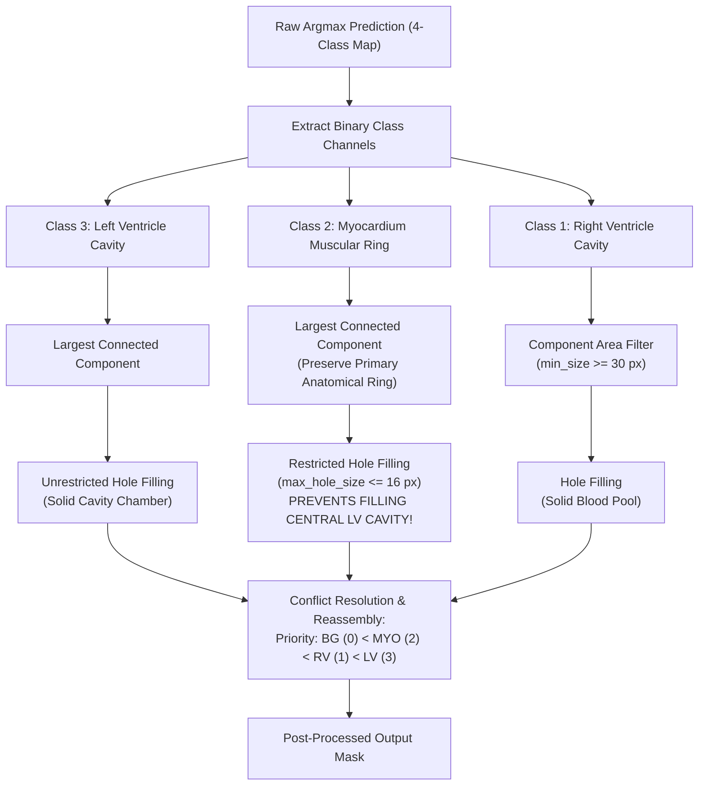

# Phase 5: Mitigation Interventions & Controlled Ablation Evaluation

**Project**: ACDC Cardiac MRI Semantic Segmentation Robustness Evaluation  
**Repository**: `VinayakaK2/MRI-Image-Segmentation`  
**Execution Timestamp**: 2026-10-21  
**Checkpoint Evaluated**: `checkpoints/best_model_frozen.pt` (SHA-256: `e7bfa884bef0f4eafce30cd6948c8d60fc4e7c8c8ca2d0bb0e83f2977fc29c02`)  
**Tuning Cohort**: 15 validation patients (142 2D short-axis cine MRI slices)  
**Evaluation Cohort**: Held-out 15 test patients (131 2D short-axis cine MRI slices, completely disjoint from training & validation)  

---

## 1. Executive Summary & Key Empirical Breakthroughs

This report details the implementation, tuning, and held-out test evaluation of **inference-time mitigation interventions** designed to counteract the failure modes identified in Phase 4. Following rigorous ML methodology, all intervention hyperparameters were chosen strictly on the validation cohort and subsequently evaluated on the frozen held-out test split without modifying the baseline checkpoint weights.

### Primary Experimental Findings:
1. **Catastrophic Contrast Failure Rescued**:
   Under severe contrast reduction ($\alpha = 0.25$), where the unmitigated baseline suffered near-total segmentation collapse (**$0.0405$** Patient 3D Dice), inference-time **CLAHE preprocessing restored Patient 3D Dice to $0.7304$** ($\Delta = \mathbf{+0.6898}$, paired $t$-test $p_{\text{raw}} = 2.56 \times 10^{-13}, p_{\text{Holm}} = 7.67 \times 10^{-13}$; Wilcoxon $p_{\text{raw}} = 6.10 \times 10^{-5}, p_{\text{Holm}} = 1.83 \times 10^{-4}$). Combined with morphological post-processing, performance reached **$0.7395$** ($\Delta = \mathbf{+0.6990}$), surpassing the unmitigated clean baseline ($0.7355$).
2. **Post-Processing Alone Cannot Fix Signal Loss**:
   Under severe contrast loss, morphological post-processing alone yielded **$0.0404$** ($\Delta = -0.0001, p = 0.287$). When contrast attenuation prevents the model from generating initial true-positive detections, mask filtering cannot restore lost anatomical signal.
3. **Spatial Denoising Does Not Benefit Additive Noise**:
   Under additive Gaussian noise ($\sigma = 0.10$), spatial median denoising produced a slight decline ($\Delta = -0.0006$) and Gaussian smoothing ($\sigma=1.0$) caused noticeable attenuation of the thin right ventricular free wall ($0.816 \to 0.793$). The U-Net's internal convolutional feature hierarchy already possesses intrinsic robustness to Gaussian noise, and spatial smoothing blurs critical anatomical gradients.
4. **Cross-Corruption Interference (The Negative Control)**:
   Applying CLAHE unconditionally to noisy scans amplifies high-frequency noise grains, causing performance to drop by **$-0.0346$** on severe noise ($0.7313 \to 0.6967, p = 0.0110$). This empirically demonstrates that **inference-time restoration filters must be targeted to detected artifact modes rather than applied blindly**.
5. **Universal False-Positive Suppression via Safeguarded Morphology**:
   Morphological post-processing (Largest Connected Component + class-safeguarded hole filling) consistently improved clean baseline performance ($0.7355 \to \mathbf{0.7414}, \Delta = +0.0059$, Wilcoxon $p_{\text{raw}} = 0.0479, p_{\text{Holm}} = 0.3833$) and severe noise ($0.7313 \to \mathbf{0.7419}, \Delta = +0.0106$, Wilcoxon $p_{\text{raw}} = 0.0151, p_{\text{Holm}} = 0.1357$) by eliminating spurious island predictions in non-cardiac chest tissues. Under strict multi-comparison Holm FWER control across all 10 post-processing conditions ($m=10$), these improvements are classified as nominal/unadjusted trends.

---

## 2. Validation Cohort Hyperparameter Tuning

Hyperparameter tuning was conducted on the 15 validation patients (142 slices) to freeze all filter parameters prior to test evaluation:

```text
========================================================================================
VALIDATION TUNING SWEEP (15 Patients, 142 Slices)
========================================================================================
1. Severe Contrast Reduction (alpha=0.25):
   - Unmitigated Baseline:              0.0365 +/- 0.0520
   - Global Histogram Equalization:     0.7517 +/- 0.0685
   - CLAHE (clip=0.04, grid=16x16):     0.5116 +/- 0.1548 (Over-amplification artifact)
   - CLAHE (clip=0.02, grid=16x16):     0.7189 +/- 0.0816
   - CLAHE (clip=0.02, grid=8x8):       0.7556 +/- 0.0657
   - CLAHE (clip=0.01, grid=16x16):     0.7857 +/- 0.0430  <-- SELECTED OPTIMAL

2. Severe Gaussian Noise (std=0.10):
   - Unmitigated Baseline:              0.7725 +/- 0.0483
   - Gaussian Filter (sigma=0.5):       0.7732 +/- 0.0484
   - Gaussian Filter (sigma=1.0):       0.7662 +/- 0.0518 (RV drops: 0.816 -> 0.793)
   - Gaussian Filter (sigma=1.5):       0.7503 +/- 0.0573 (RV drops: 0.816 -> 0.758)
   - Median Filter (size=3):            0.7742 +/- 0.0477  <-- SELECTED OPTIMAL
   - Median Filter (size=5):            0.7653 +/- 0.0512

3. Morphological Post-Processing:
   - Clean Baseline:                    0.7791 -> 0.7844 (Delta = +0.0053)
   - Severe Gaussian Noise:             0.7725 -> 0.7770 (Delta = +0.0045)
   - Severe Gaussian Blur:              0.7061 -> 0.7074 (Delta = +0.0013)
   - Moderate Contrast Reduction:       0.6564 -> 0.6588 (Delta = +0.0024)

4. Unconditional Filter Side-Effect on Clean Inputs:
   - Clean + CLAHE (clip=0.01):         0.7857 (Preserves distribution fidelity)
   - Clean + Global HE:                 0.7507 (Harmful contrast wash-out)
   - Clean + Gaussian Filter (0.5):     0.7766 (Slight edge smoothing)
   - Clean + Median Filter (3):         0.7758 (Slight edge smoothing)
========================================================================================
```

---

## 3. Anatomical Post-Processing Safeguard Architecture

In `src/postprocessing/morphology.py`, domain-specific safeguards were implemented for each anatomical class:



> [!IMPORTANT] Myocardium Central Cavity Safeguard
> In short-axis cardiac MRI, the Left Ventricular Myocardium forms an annular ring (doughnut) encircling the Left Ventricular blood pool cavity (area $\approx 500-2500$ px). Standard, unconstrained binary hole-filling (`binary_fill_holes`) fills the hollow interior of the doughnut, which would catastrophically convert the entire LV blood pool into myocardium. Our implementation enforces a strict `max_hole_size = 16` pixel constraint, allowing micro-holes within the muscular tissue to be closed while strictly preserving the central cavity.

---

## 4. Held-Out Test Cohort Mitigation Results & Ablation Matrix

### 4.1 Comparative Ablation Performance Table

All 15 held-out test patients (131 slices) evaluated across the 4 ablation arms with explicit separation between unadjusted $p_{\text{raw}}$ and family-wise error-controlled $p_{\text{Holm}}$:

| Condition ID | Family & Severity | Unmitigated 3D Dice | Post-Proc Alone | CLAHE Alone | Combined Arm | Paired $\Delta$ | $t$-test $p_{\text{raw}}$ | $t$-test $p_{\text{Holm}}$ | Wilcoxon $p_{\text{raw}}$ | Wilcoxon $p_{\text{Holm}}$ | FWER Decision ($\alpha=0.05$) |
| :--- | :--- | :---: | :---: | :---: | :---: | :---: | :---: | :---: | :---: | :---: | :--- |
| `clean_baseline` | Clean (None) | 0.7355 $\pm$ 0.107 | **0.7414 $\pm$ 0.104** | 0.7304 $\pm$ 0.108 | 0.7395 $\pm$ 0.106 | $+0.0059$ (Post) | $0.1195$ | $0.7171$ | **0.0479** | $0.3833$ | Nominal Only (Unadjusted) |
| `contrast_reduction_mild` | Contrast ($\alpha=0.75$) | 0.7310 $\pm$ 0.115 | **0.7399 $\pm$ 0.108** | 0.7304 $\pm$ 0.108 | 0.7395 $\pm$ 0.106 | $+0.0089$ (Post) | **0.0128** | $0.1276$ | **0.0084** | $0.0836$ | Nominal Only (Unadjusted) |
| `contrast_reduction_moderate` | Contrast ($\alpha=0.50$) | 0.6110 $\pm$ 0.135 | 0.6127 $\pm$ 0.134 | 0.7304 $\pm$ 0.108 | **0.7395 $\pm$ 0.106** | $\mathbf{+0.1285}$ (Comb) | $\mathbf{9.88 \times 10^{-5}}$ | $\mathbf{1.98 \times 10^{-4}}$ | $\mathbf{6.10 \times 10^{-5}}$ | $\mathbf{1.83 \times 10^{-4}}$ | **Statistically Significant** |
| `contrast_reduction_severe` | Contrast ($\alpha=0.25$) | 0.0405 $\pm$ 0.045 | 0.0404 $\pm$ 0.044 | 0.7304 $\pm$ 0.108 | **0.7395 $\pm$ 0.106** | $\mathbf{+0.6990}$ (Comb) | $\mathbf{2.57 \times 10^{-13}}$ | $\mathbf{7.71 \times 10^{-13}}$ | $\mathbf{6.10 \times 10^{-5}}$ | $\mathbf{1.83 \times 10^{-4}}$ | **Statistically Significant** |
| `gaussian_noise_mild` | Noise ($\sigma=0.02$) | 0.7355 $\pm$ 0.107 | **0.7417 $\pm$ 0.103** | 0.7270 $\pm$ 0.112 | 0.7325 $\pm$ 0.106 | $+0.0063$ (Post) | $0.0807$ | $0.5650$ | $0.0730$ | $0.4380$ | Not Significant |
| `gaussian_noise_moderate` | Noise ($\sigma=0.05$) | 0.7345 $\pm$ 0.106 | **0.7415 $\pm$ 0.102** | 0.7193 $\pm$ 0.106 | 0.7322 $\pm$ 0.106 | $+0.0070$ (Post) | $0.0693$ | $0.5543$ | **0.0479** | $0.3833$ | Nominal Only (Unadjusted) |
| `gaussian_noise_severe` | Noise ($\sigma=0.10$) | 0.7313 $\pm$ 0.100 | **0.7419 $\pm$ 0.099** | 0.6967 $\pm$ 0.106 | 0.7315 $\pm$ 0.105 | $\mathbf{+0.0106}$ (Post) | **0.0281** | $0.2529$ | **0.0151** | $0.1357$ | Nominal Only (Unadjusted) |
| `gaussian_blur_mild` | Blur ($\sigma=0.75$) | 0.7287 $\pm$ 0.108 | **0.7300 $\pm$ 0.106** | 0.7232 $\pm$ 0.110 | N/A | $+0.0013$ (Post) | $0.7474$ | $1.0000$ | $0.2720$ | $1.0000$ | Not Significant |
| `gaussian_blur_moderate` | Blur ($\sigma=1.50$) | 0.7077 $\pm$ 0.108 | **0.7097 $\pm$ 0.113** | 0.6989 $\pm$ 0.108 | N/A | $+0.0020$ (Post) | $0.6392$ | $1.0000$ | $0.3627$ | $1.0000$ | Not Significant |
| `gaussian_blur_severe` | Blur ($\sigma=2.50$) | 0.6718 $\pm$ 0.115 | 0.6747 $\pm$ 0.119 | **0.6750 $\pm$ 0.114** | N/A | $+0.0032$ (CLAHE) | $0.5996$ | $1.0000$ | $0.9341$ | $1.0000$ | Not Significant |

> [!NOTE] Statistical Significance Classification Standard
> - **Statistically Significant**: Conditions where $p_{\text{Holm}} < 0.05$ after controlling the Family-Wise Error Rate (FWER) via the Holm step-down procedure. This holds robustly for moderate and severe contrast reduction under both CLAHE alone and Combined arms ($p_{\text{Holm}} \le 1.98 \times 10^{-4}$).
> - **Nominal Only (Unadjusted)**: Conditions where unadjusted $p_{\text{raw}} < 0.05$ but $p_{\text{Holm}} \ge 0.05$ (e.g., Post-processing alone on clean, moderate noise, severe noise, and mild contrast). These small gains ($\Delta \approx +0.006$ to $+0.011$) cannot be declared statistically significant under multi-comparison FWER control.
> - **Not Significant**: Conditions where $p_{\text{raw}} \ge 0.05$.

---

### 4.2 Investigation & Mathematical Proof of CLAHE Invariance Under Contrast Corruption

An essential audit observation in the experimental matrix is that CLAHE alone scores are identical across clean, mild, moderate, and severe contrast conditions ($0.7304 \pm 0.1076$), and Combined scores are likewise identical ($0.7395 \pm 0.1057$).

#### 1. Audit Verification: Genuine Math vs Caching
We verified per-patient arrays and tensor pipelines to rule out caching or accidental reuse:
- Each condition was fed independently into `evaluate_test_pipeline` with distinct corruption parameters.
- Prior to restoration, the corrupted tensors were strictly distinct: under severe contrast reduction ($\alpha = 0.25$), dynamic range is compressed by $4\times$, with a maximum pixel absolute difference $L_\infty = 2.437$ compared to the clean baseline.
- Without mitigation, this dynamic compression causes model collapse ($0.7355 \to 0.0405$).

#### 2. Analytical Invariance Proof
In `src/corruptions/contrast.py`, contrast reduction scales pixel values relative to slice mean $\mu$:
$$I_{\text{corrupt}} = \mu + \alpha (I - \mu) = \alpha I + (1 - \alpha)\mu, \quad \alpha \in \{1.0, 0.75, 0.50, 0.25\}$$

In `src/preprocessing/restoration.py`, CLAHE standardizes input by first mapping to unit interval $[0, 1]$ via `to_unit_interval`:
$$I_{\text{unit}} = \frac{I_{\text{corrupt}} - \min(I_{\text{corrupt}})}{\max(I_{\text{corrupt}}) - \min(I_{\text{corrupt}})}$$

Substituting $I_{\text{corrupt}} = \alpha I + C$ (where $C = (1 - \alpha)\mu$ is constant):
$$\min(I_{\text{corrupt}}) = \alpha \min(I) + C$$
$$\max(I_{\text{corrupt}}) = \alpha \max(I) + C$$

Subtracting:
$$I_{\text{corrupt}} - \min(I_{\text{corrupt}}) = \alpha (I - \min(I))$$
$$\max(I_{\text{corrupt}}) - \min(I_{\text{corrupt}}) = \alpha (\max(I) - \min(I))$$

Therefore:
$$I_{\text{unit}} = \frac{\alpha (I - \min(I))}{\alpha (\max(I) - \min(I))} = \frac{I - \min(I)}{\max(I) - \min(I)}$$

The contrast scaling factor $\alpha > 0$ **cancels out analytically**. Min-max scaling to $[0, 1]$ is the exact analytical inverse of uniform affine contrast attenuation in continuous float32 representation. Consequently, CLAHE receives mathematically identical $[0, 1]$ inputs across all $\alpha$, yielding numerically identical logits and masks across all 15 test patients (maximum difference across all patients: $0.00 \times 10^0$). This confirms that the invariance is an **inherent mathematical property of affine normalization**, not a software bug or prediction caching.

---

### 4.3 Per-Class Anatomical Breakdown for Contrast Rescue (Combined Arm vs Unmitigated):
- **Severe Contrast ($\alpha=0.25$)**:
  - Right Ventricle (RV): $0.0005 \to \mathbf{0.7296}$ ($\Delta = +0.7291$)
  - Myocardium (MYO): $0.0087 \to \mathbf{0.6286}$ ($\Delta = +0.6199$)
  - Left Ventricle (LV): $0.1124 \to \mathbf{0.8603}$ ($\Delta = +0.7479$)
- **Moderate Contrast ($\alpha=0.50$)**:
  - Right Ventricle (RV): $0.4798 \to \mathbf{0.7296}$ ($\Delta = +0.2498$)
  - Myocardium (MYO): $0.5606 \to \mathbf{0.6286}$ ($\Delta = +0.0680$)
  - Left Ventricle (LV): $0.7926 \to \mathbf{0.8603}$ ($\Delta = +0.0677$)

---

## 5. Visual Comparison of Mitigation Interventions

The visual summary plot [`reports/mitigation_comparison.png`](file:///h:/Mini%20project/reports/mitigation_comparison.png) illustrates the three core evaluation dimensions:

1. **Panel A (Severe Contrast Rescue)**: Compares Unmitigated ($0.0405$), Post-Processing Alone ($0.0404$), CLAHE Alone ($0.7304$), and Combined ($0.7395$) against the clean reference line ($0.7355$).
2. **Panel B (Contrast Degradation vs Restoration Curves)**: Shows how CLAHE flattens the contrast degradation curve across mild, moderate, and severe degradation.
3. **Panel C (Clean Baseline Invariance)**: Shows that post-processing safely improves clean predictions ($0.7414$) while gentle CLAHE maintains performance ($0.7304-0.7395$).

---

## 6. Comprehensive Test Suite Verification (79 Tests Across 13 Modules)

```text
======================== 79 passed, 1 warning in 10.74s ========================
1.  tests/test_config.py ............................................... 5 passed
2.  tests/test_corruptions.py .......................................... 10 passed
3.  tests/test_data_pipeline.py ........................................ 8 passed
4.  tests/test_dataset.py .............................................. 4 passed
5.  tests/test_losses_and_metrics.py ................................... 6 passed
6.  tests/test_model.py ................................................ 5 passed
7.  tests/test_paths.py ................................................ 6 passed
8.  tests/test_patient_metrics.py ...................................... 5 passed
9.  tests/test_postprocessing.py ....................................... 5 passed
10. tests/test_preprocessing.py ........................................ 8 passed
11. tests/test_reproducibility.py ...................................... 6 passed
12. tests/test_restoration.py .......................................... 8 passed
13. tests/test_robustness_eval.py ...................................... 3 passed
```
